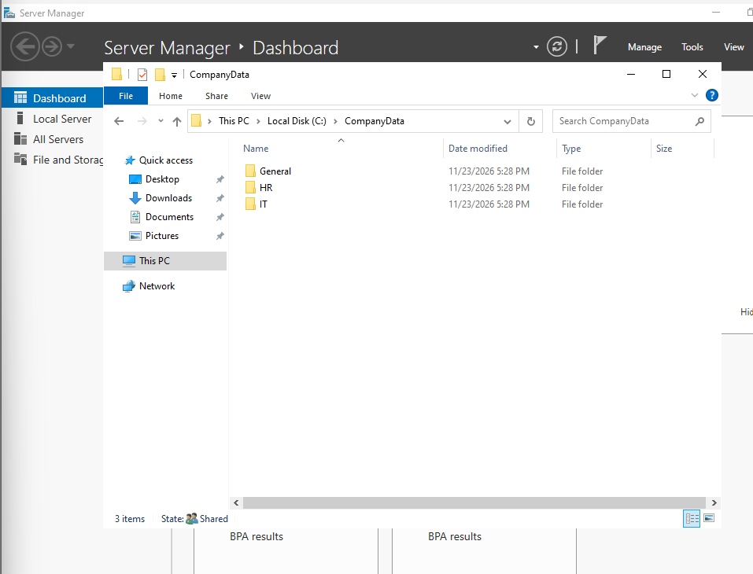
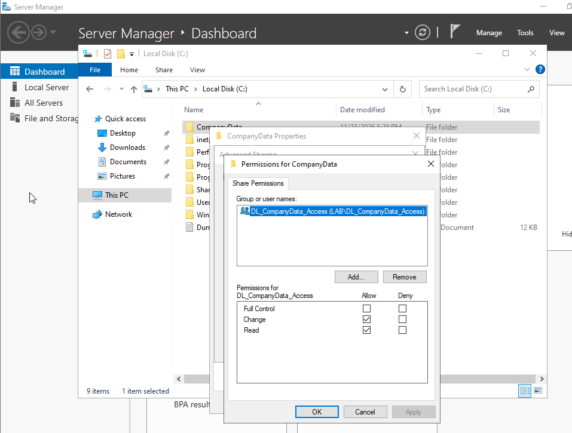
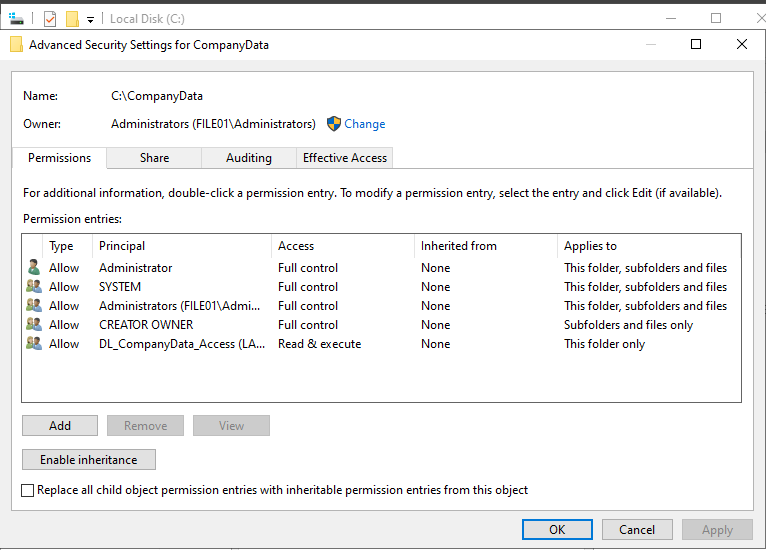

# File Server Overview

## 1. Purpose

This document outlines the file server configuration implemented within the homelab Active Directory environment.

The objective is to demonstrate centralized file storage, network share management, and access control through SMB shares and NTFS permissions.

The configuration uses Active Directory security groups to manage resource access according to organizational requirements, following the principle of least privilege.

## 2. Environment Details

- **File Server:** FILE01
- **Operating System:** Windows Server 2022
- **Active Directory Domain:** `lab.test`
- **Domain Controller:** DC01
- **File Sharing Protocol:** Server Message Block (SMB)
- **Permission Management:** Active Directory Security Groups and NTFS Permissions

## 3. SMB Share Configuration

A centralized SMB network share was configured on FILE01 to provide domain users with access to shared company resources.

**Share Details:**

- **Share Name:** CompanyData
- **UNC Path:** `\\FILE01\CompanyData`
- **Hosting Server:** FILE01
- **Sharing Protocol:** Server Message Block (SMB)

### Share-Level Permissions

The SMB share permissions were configured to allow authorized domain users to access and modify shared resources.

- **Security Group:** `DL_CompanyData_Access`
- **Permissions:** Read and Change
- **Full Control:** Not granted

Share-level permissions provide an additional layer of access control, working together with NTFS permissions to determine the effective access users receive.

## 4. NTFS Permission Configuration

NTFS permissions were configured to provide granular access control over the department-specific folders within the CompanyData share.

The configuration uses Active Directory Domain Local security groups to assign permissions rather than granting access directly to individual user accounts.

### Parent Folder Permissions

The parent CompanyData folder grants the `DL_CompanyData_Access` group **Read & Execute** permissions.

This provides authorized users with access to the parent folder structure, while department-specific permissions are configured at the individual subfolder level.

### Department-Level Permissions

Individual department folders use their respective Domain Local security groups to control access to their contents.

**Example: HR Department**

- **Folder:** HR
- **Security Group:** `DL_HR_Modify`
- **Permission Level:** Modify

This approach allows department-specific permissions to be managed independently while maintaining centralized access control through Active Directory.

## 5. Active Directory Integration

The file server uses Active Directory security groups to manage access to shared resources.

The AGDLP group structure separates user membership from resource permissions, allowing administrators to manage access through group membership rather than assigning permissions directly to individual users.

**Example Group Configuration:**

- `GG_Company_Users` – Global security group containing authorized domain users.
- `DL_CompanyData_Access` – Domain Local security group containing `GG_Company_Users` as a member and assigned SMB share permissions.
- `DL_HR_Modify` – Domain Local security group assigned Modify permissions on the HR department folder.

This demonstrates the AGDLP approach:

**Accounts → Global Groups → Domain Local Groups → Permissions**

## 6. Access Verification and Testing

Network access to the CompanyData SMB share was tested from CLIENT01 using domain user accounts.

Testing confirmed that:

- The SMB share was accessible through its UNC path: `\\FILE01\CompanyData`.
- Users with the appropriate security group membership could access their assigned department folders.
- NTFS permissions enforced department-specific access restrictions.
- Share-level and NTFS permissions worked together to provide the intended resource access.

These tests verified that the file server, Active Directory security groups, and NTFS access controls were functioning as intended.

## 7. Administrative Benefits and Skills Demonstrated

**Administrative Capabilities Demonstrated:**

- Configuring and managing SMB network shares.
- Managing share-level and NTFS permissions.
- Managing folder permissions and inheritance.
- Implementing least-privilege access controls.
- Using Active Directory security groups to manage resource access.
- Applying department-specific permissions.
- Testing network share accessibility and user permissions.
- Troubleshooting file and folder access configurations.

**Operational Benefits:**

- Centralizes shared company data.
- Provides controlled access to department resources.
- Simplifies permission management through security groups.
- Separates share-level permissions from file-system permissions.
- Supports consistent and scalable resource administration.

## 8. Future Development

Planned areas for continued development include additional department permission scenarios, PowerShell administration, and further file server troubleshooting.

This project represents hands-on file server administration within a personal homelab environment.

## Screenshots

### CompanyData Folder Structure

### SMB Share Permissions

### NTFS Permissions

