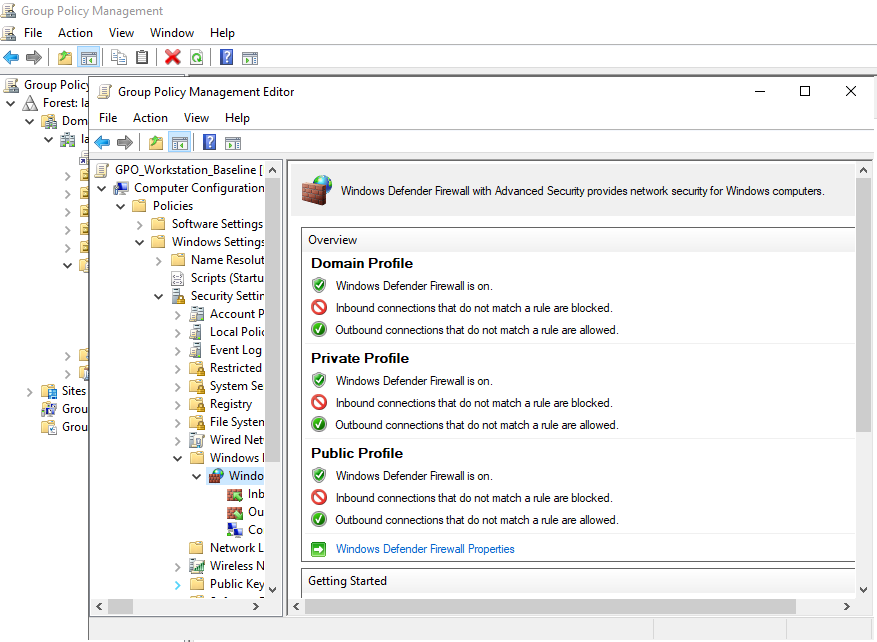

# Group Policy Overview

## 1. Purpose

This document describes the Group Policy configurations implemented within the personal IT homelab environment.

The objective was to demonstrate centralized workstation configuration, security policy management, and user-specific resource access through Group Policy.

## 2. Environment Details

- **Domain:** `lab.test`
- **Domain Controller:** DC01
- **Operating System:** Windows Server 2022
- **Client Workstation:** CLIENT01 (Windows 11 Pro)
- **Management Tool:** Group Policy Management Console (GPMC)

Group Policy Objects were created and linked to appropriate Active Directory Organizational Units to manage domain workstation settings.

## 3. Workstation Security Baseline

A Group Policy Object named `GPO_Workstation_Baseline` was created and linked to the Workstations Organizational Unit.

The policy establishes a baseline of security settings for domain-joined workstations.

### Configured Security Settings

**Windows Defender Antivirus**
- Enabled real-time protection.
- Enabled behavior monitoring.
- Maintained antivirus protection through centralized policy configuration.

**Windows Firewall**
- Enabled Windows Firewall for Domain, Private, and Public network profiles.

**Workstation Inactivity Lock**
- Configured workstations to lock after 10 minutes of inactivity.

These settings demonstrate centralized security configuration and consistent policy enforcement across domain-joined workstations.

## 4. Domain Password Policy

Domain password policy settings were configured through Group Policy to establish centralized password requirements for domain accounts.

Account administration was also performed through Active Directory Users and Computers, including:

- Resetting user passwords.
- Unlocking user accounts.
- Managing domain user accounts.

This demonstrates the relationship between Group Policy security settings and routine Active Directory account administration.

## 5. Group Policy Verification

Group Policy application was verified on CLIENT01 to confirm that the configured settings were being received by the domain-joined workstation.

Verification included:

- Refreshing Group Policy settings.
- Reviewing applied policies on CLIENT01.
- Confirming the workstation security baseline was applied.
- Testing user drive mappings using domain accounts.

The verification process confirmed that the configured policies were being applied as intended.

## 6. User Drive Mapping

A separate Group Policy Object named `GPO_User_Drive_Mappings` was created to automate access to shared network resources.

Group Policy Preferences were used to configure network drive mappings.

### Security Group-Based Targeting

Item-level targeting was configured to apply drive mappings based on Active Directory security group membership.

This allows users to receive access to the appropriate shared resources based on their assigned group memberships.

The drive mappings reference shared folders hosted on FILE01.

### Verification

Drive mappings were tested from CLIENT01 using domain user accounts with different security group memberships.

Testing confirmed that the appropriate network drives were mapped based on the configured targeting conditions.

## 7. Administrative Tools and Skills Demonstrated

**Administrative Tools:**
- Group Policy Management Console (GPMC)
- Active Directory Users and Computers (ADUC)
- Windows Command Prompt
- Windows PowerShell

**Skills Demonstrated:**
- Creating and managing Group Policy Objects.
- Linking GPOs to Active Directory Organizational Units.
- Configuring workstation security policies.
- Managing Windows Defender and Firewall settings through Group Policy.
- Configuring domain password policies.
- Implementing Group Policy Preferences.
- Configuring security group-based item-level targeting.
- Verifying Group Policy application.
- Troubleshooting policy and drive mapping behavior.

## 8. Future Development

Planned areas for continued development include additional Group Policy configurations, PowerShell-based administration, and further policy troubleshooting scenarios.

This project represents hands-on Group Policy administration within a personal homelab environment.

## Screenshots

### Workstation Group Policy Object Baseline

### Windows Firewall Configuration

### User Drive Mapping Configuration

