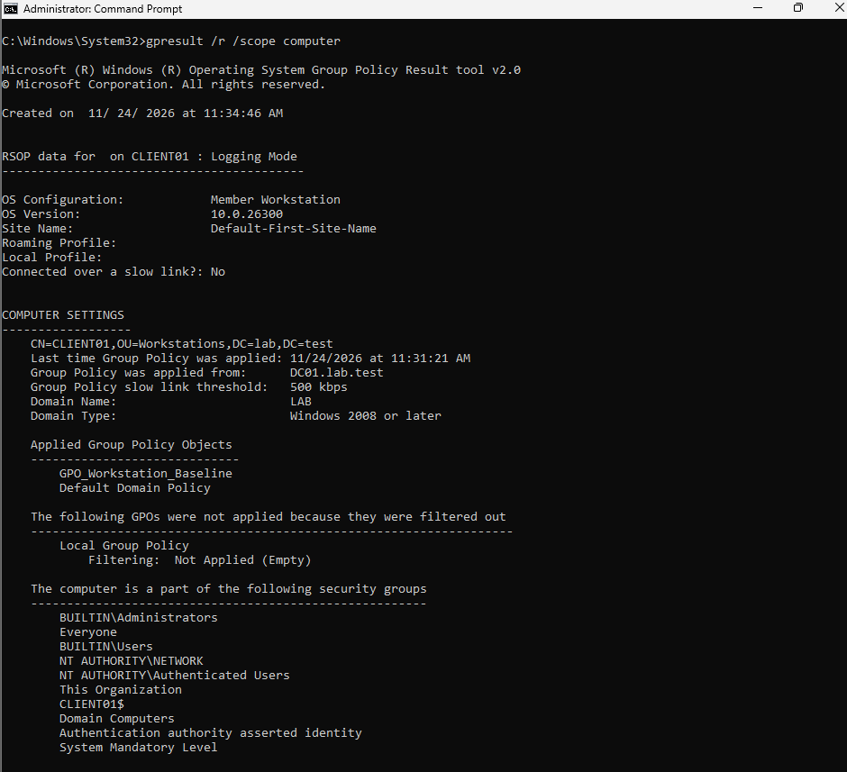
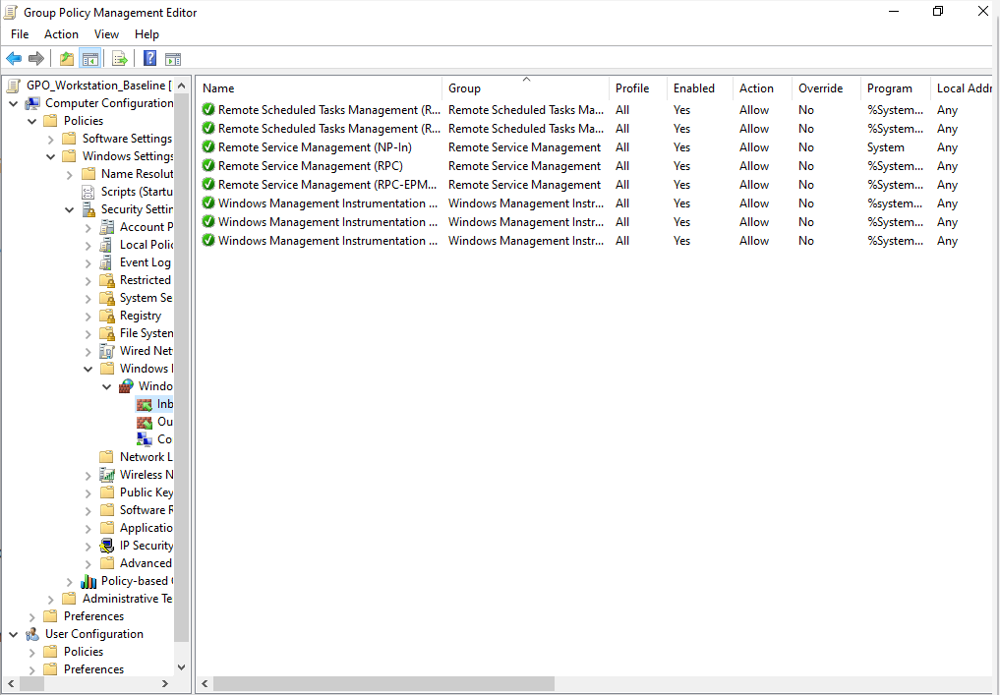
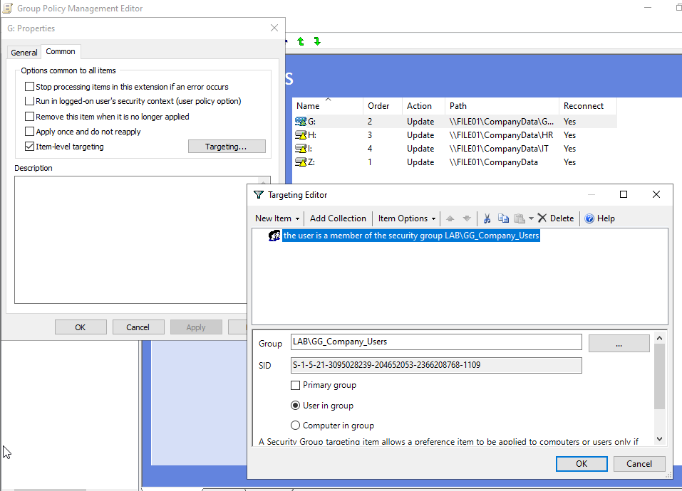

# Active Directory Overview

## 1. Purpose

This document outlines the Active Directory Domain Services (AD DS) environment deployed within the homelab.

The objective is to demonstrate centralized identity management, organizational structure, security group administration, and integration with Windows network services.

## 2. Environment Details

- **Domain:** `lab.test`
- **Domain Controller:** DC01
- **Operating System:** Windows Server 2022
- **Directory Service:** Active Directory Domain Services
- **DNS Server:** DC01
- **DHCP Server:** DC01

## 3. Organizational Unit Structure

The Active Directory domain uses Organizational Units (OUs) to organize directory objects and support centralized administration.

Configured OUs:

- Employees
- Groups
- Servers
- Workstations

This structure separates users, security groups, servers, and workstation computer accounts for easier administration and policy management.

## 4. Security Group Administration

Security groups were created to organize user access and manage permissions to shared resources.

**Examples:**

- `GG_Company_Users` — Global security group containing authorized domain users.
- `DL_CompanyData_Access` — Domain Local security group used to manage access to the CompanyData share.
- `DL_HR_Modify` — Domain Local security group assigned Modify permissions on the HR department folder.

### AGDLP Group Strategy

The environment uses the AGDLP model:

**Accounts → Global Groups → Domain Local Groups → Permissions**

This approach separates user membership from resource permissions and simplifies access administration.

## 5. User and Account Administration

Administrative tasks performed through Active Directory Users and Computers included:

- Creating and managing domain user accounts.
- Managing computer accounts.
- Organizing directory objects within Organizational Units.
- Creating and managing security groups.
- Resetting user passwords.
- Unlocking user accounts.
- Managing group membership to control resource access.

Domain password requirements were configured through Group Policy.

## 6. File Server Integration

Active Directory security groups are used to manage access to shared resources hosted on FILE01.

**Example configuration:**

- `GG_Company_Users` is a member of `DL_CompanyData_Access`.
- `DL_CompanyData_Access` provides access to the parent CompanyData folder.
- `DL_HR_Modify` provides Modify permissions on the HR department folder.

This group-based approach avoids assigning resource permissions directly to individual user accounts.

## 7. Access Verification

Directory and resource access configurations were tested using domain user accounts from CLIENT01.

Testing confirmed that:

- Users received access based on their security group membership.
- Authorized users could access their assigned department resources.
- NTFS permissions enforced department-specific access restrictions.

These tests verified that Active Directory group membership and file server permissions worked together as intended.

## 8. Administrative Tools

The following Windows administrative tools were used:

- **Active Directory Users and Computers:** User, computer, OU, and security group administration.
- **Group Policy Management Console:** Centralized policy configuration.
- **Windows Command Prompt:** Network and system verification.
- **Windows administrative utilities:** Testing domain connectivity and resource accessibility.

## 9. Skills Demonstrated

- Active Directory Domain Services administration.
- Organizational Unit design and management.
- User and computer account administration.
- Security group creation and management.
- AGDLP group nesting.
- Password resets and account unlocks.
- Group-based resource access management.
- Integration of Active Directory with file server permissions.
- Verification of user access and directory configurations.

## 10. Future Development

Planned areas for continued development include Ubuntu domain integration, PowerShell administration and automation, and additional Active Directory troubleshooting scenarios.

This project represents hands-on experience within a personal homelab environment.

## Screenshots

### Workstation Security Baseline

### Windows Firewall Configuration

### User Drive Mapping Configuration

