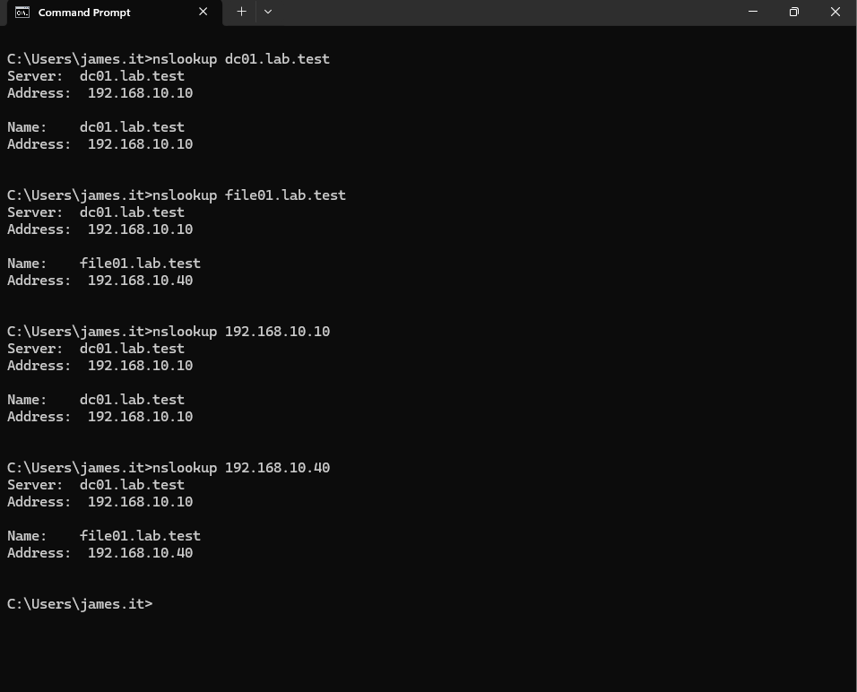
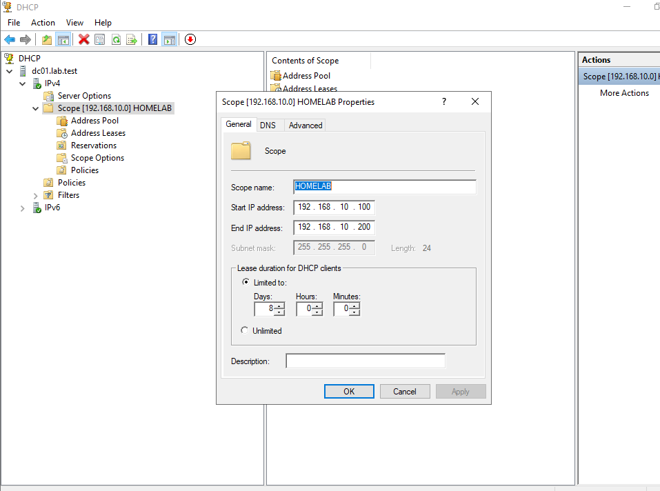

# Network Infrastructure Overview

## 1. Purpose

This document describes the network configuration supporting the personal IT homelab environment.

The project demonstrates virtual network configuration, static and dynamic IP addressing, DHCP scope management, DNS configuration, and network connectivity verification.

## 2. Virtual Network Configuration

The homelab environment was built using Oracle VirtualBox.

The virtual machines communicate through an isolated VirtualBox Internal Network.

**Connected Systems:**

- DC01 – Windows Server 2022
- FILE01 – Windows Server 2022
- CLIENT01 – Windows 11 Pro

The internal network provides connectivity between the virtual machines without exposing the lab environment directly to the external network.

A temporary NAT adapter was used when internet access was required for system updates and software installation. It was disabled afterward to restore the isolated network configuration.

## 3. IP Addressing Configuration

The homelab uses the `192.168.10.0/24` subnet.

| System | IP Address | Assignment |
|---|---|---|
| DC01 | 192.168.10.10 | Static |
| FILE01 | 192.168.10.40 | Static |
| CLIENT01 | 192.168.10.100 | DHCP |

The domain controller uses a static IP address to provide consistent network services to the environment.

FILE01 also uses a static address to maintain reliable access to shared network resources.

CLIENT01 receives its network configuration dynamically through DHCP.

## 4. DHCP Configuration

The DHCP Server role was configured on DC01 to provide automatic IP address assignment to domain clients.

**DHCP Scope Details:**

- **Scope Name:** HOMELAB
- **Network:** 192.168.10.0/24
- **Address Range:** 192.168.10.100 – 192.168.10.200
- **DHCP Server:** DC01

### DHCP Scope Options

The following scope options were configured:

- **Option 006 – DNS Servers:** 192.168.10.10
- **Option 015 – DNS Domain Name:** lab.test
- **Option 003 – Router:** Not configured because the isolated internal network does not use a default gateway.

CLIENT01 was configured to obtain its network settings automatically through DHCP.

The assigned lease was verified through the DHCP management console.

## 5. DNS Configuration

The DNS Server role was configured on DC01 to provide name resolution for the Active Directory domain.

### Forward Lookup Zone

An Active Directory-integrated forward lookup zone was configured:

- **Zone Name:** `lab.test`
- **DNS Server:** DC01
- **Integration:** Active Directory

The zone contains the DNS records required for domain services and host name resolution.

Active Directory service records were verified, including:

- `_msdcs`
- `_sites`
- `_tcp`
- `_udp`
- `DomainDNSZones`
- `ForestDNSZones`

Host records were also verified for DC01, FILE01, and CLIENT01.

### Reverse Lookup Zone

A reverse lookup zone was configured for the `192.168.10.0/24` subnet.

- **Zone Name:** `10.168.192.in-addr.arpa`
- **Zone Type:** Primary, Active Directory-integrated
- **Dynamic Updates:** Secure only

PTR records were verified for the following systems:

- 192.168.10.10 – DC01
- 192.168.10.40 – FILE01
- 192.168.10.100 – CLIENT01

## 6. DHCP and Dynamic DNS Integration

DHCP was configured to dynamically register client DNS records.

The DHCP server was configured to:

- Always dynamically update A and PTR records.
- Discard records when the corresponding DHCP lease is deleted.
- Dynamically update DNS records for clients that do not request updates.

CLIENT01's DHCP lease was renewed to verify automatic DNS registration.

The resulting A and PTR records were checked in DNS Manager, confirming that DHCP and DNS were working together as intended.

## 7. Network Verification and Testing

Network services were tested from CLIENT01 to verify connectivity and name resolution.

Testing included:

- Verifying DHCP address assignment and lease information.
- Confirming DNS resolution for domain systems.
- Performing forward and reverse DNS lookups.
- Verifying domain controller name resolution.
- Confirming that DHCP dynamically registered client DNS records.

These tests demonstrated that the network infrastructure was providing the necessary services for Active Directory, file sharing, and domain-joined workstation operations.

## 8. Administrative Tools and Skills Demonstrated

**Administrative Tools:**

- Windows Server DHCP Manager
- Windows Server DNS Manager
- Windows Command Prompt
- Windows PowerShell

**Skills Demonstrated:**

- Configuring virtual network connectivity.
- Implementing static and dynamic IP addressing.
- Creating and managing DHCP scopes.
- Configuring DHCP scope options.
- Managing forward and reverse DNS lookup zones.
- Verifying DNS records and name resolution.
- Configuring DHCP dynamic DNS updates.
- Troubleshooting network connectivity and name resolution.

## 9. Future Development

Planned areas for continued development include additional network troubleshooting scenarios, PowerShell-based administration, and integrating the available Ubuntu Desktop system into the Active Directory environment.

## Screenshots

### DNS Resolution from CLIENT01

### DHCP Lease Assignment

